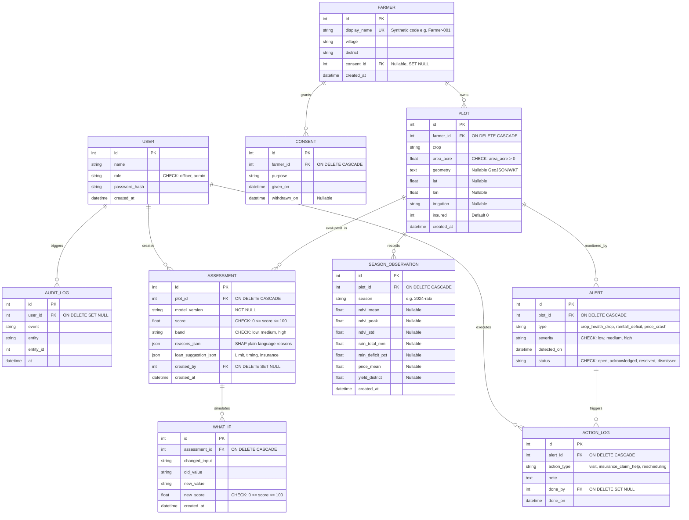

# SatBhoomi Score + Raksha — Data Model Specification

This document details the relational schema, constraints, entity relationships, and data lifecycle policies for **SatBhoomi Score + Raksha**, implementing Section 7 of the Product Blueprint.

---

## 1. Entity-Relationship Diagram (Mermaid)

---

## 2. Table Specifications

### 2.1 `user`
System users who interact with the loan assessment and alert modules.
- **Constraints**: `CHECK(role IN ('officer', 'admin'))`
- **Fields**:
  - `id`: Primary key, integer autoincrement.
  - `name`: Full display name of the officer or administrator.
  - `role`: Role string, constrained to `officer` or `admin`.
  - `password_hash`: Salted password hash (bcrypt / argon2).
  - `created_at`: UTC timestamp.

### 2.2 `farmer`
Agricultural credit applicants and monitored farmers.
- **Privacy Rule**: Stores ONLY synthetic or anonymized identifiers (e.g. `Farmer-001`). Never stores national ID numbers (Aadhaar), bank account numbers, or phone numbers.
- **Fields**:
  - `id`: Primary key, integer autoincrement.
  - `display_name`: Unique synthetic identifier or alias. Indexed.
  - `village`: Local village name.
  - `district`: Administrative district. Indexed.
  - `consent_id`: Foreign key referencing active `consent.id` (`ON DELETE SET NULL`).
  - `created_at`: UTC timestamp.

### 2.3 `consent`
Consent audit record under India's Digital Personal Data Protection (DPDP) Act, 2023.
- **Fields**:
  - `id`: Primary key, integer autoincrement.
  - `farmer_id`: Foreign key referencing `farmer.id` (`ON DELETE CASCADE`). Indexed.
  - `purpose`: Stated processing purpose for credit evaluation and stress monitoring.
  - `given_on`: UTC timestamp when consent was granted.
  - `withdrawn_on`: Nullable UTC timestamp if consent is revoked.

### 2.4 `plot`
Farm plot polygons or centroid coordinates associated with a farmer.
- **Constraints**: `CHECK(area_acre > 0)`
- **Fields**:
  - `id`: Primary key, integer autoincrement.
  - `farmer_id`: Foreign key referencing `farmer.id` (`ON DELETE CASCADE`). Indexed.
  - `crop`: Sown crop (e.g. `wheat`).
  - `area_acre`: Physical land area in acres (must be strictly > 0).
  - `geometry`: Optional polygon WKT or GeoJSON representation.
  - `lat`, `lon`: Centroid coordinates for weather and remote sensing lookups.
  - `irrigation`: Primary irrigation method (`drip`, `canal`, `tube-well`, `flood`, `rainfed`).
  - `insured`: Flag indicating active Pradhan Mantri Fasal Bima Yojana (PMFBY) or commercial coverage (`0` = no, `1` = yes).
  - `created_at`: UTC timestamp.

### 2.5 `season_observation`
Derived seasonal metrics extracted from satellite remote sensing, gridded precipitation, and mandi price feeds.
- **Constraints**: `UNIQUE(plot_id, season)`
- **Indexes**: `idx_obs_plot` on `plot_id`
- **Fields**:
  - `id`: Primary key, integer autoincrement.
  - `plot_id`: Foreign key referencing `plot.id` (`ON DELETE CASCADE`).
  - `season`: Season identifier (e.g. `2024-rabi`).
  - `ndvi_mean`, `ndvi_peak`, `ndvi_std`: Normalized Difference Vegetation Index statistics.
  - `rain_total_mm`: Cumulative seasonal precipitation in millimeters.
  - `rain_deficit_pct`: Percentage deficit relative to the historical long-period average.
  - `price_mean`: Average local mandi price per quintal.
  - `yield_district`: Historical or forecasted district yield benchmark.
  - `created_at`: UTC timestamp.

### 2.6 `assessment`
Credit risk score calculation record and loan structure suggestion.
- **Constraints**: `CHECK(score >= 0 AND score <= 100)`, `CHECK(band IN ('low', 'medium', 'high'))`, `model_version NOT NULL`.
- **Fields**:
  - `id`: Primary key, integer autoincrement.
  - `plot_id`: Foreign key referencing `plot.id` (`ON DELETE CASCADE`). Indexed.
  - `model_version`: Required model release tag (e.g. `rules_baseline_v0.1`, `xgb_v1.0.0`).
  - `score`: Calibrated risk score (0 to 100, where higher indicates lower repayment risk).
  - `band`: Risk category (`low`, `medium`, `high`).
  - `reasons_json`: Generic JSON structure storing top 3 SHAP or heuristic plain-language reasons.
  - `loan_suggestion_json`: Generic JSON containing right-sized loan limit, recommended repayment month, and insurance requirements.
  - `created_by`: Foreign key referencing `user.id` (`ON DELETE SET NULL`). Indexed.
  - `created_at`: UTC timestamp.

### 2.7 `what_if`
Sensitivity analysis simulations projecting the impact of controllable interventions on the credit score.
- **Constraints**: `CHECK(new_score >= 0 AND new_score <= 100)`
- **Rule**: What-if outputs are strictly labeled "estimate", not proof of causation.
- **Fields**:
  - `id`: Primary key, integer autoincrement.
  - `assessment_id`: Foreign key referencing `assessment.id` (`ON DELETE CASCADE`). Indexed.
  - `changed_input`: The variable altered (e.g. `insured`, `irrigation`).
  - `old_value`: Baseline state.
  - `new_value`: Simulated intervention.
  - `new_score`: Projected model score.
  - `created_at`: UTC timestamp.

### 2.8 `alert`
Early-warning notifications for farm and repayment stress (Raksha module).
- **Constraints**: `CHECK(severity IN ('low', 'medium', 'high'))`, `CHECK(status IN ('open', 'acknowledged', 'resolved', 'dismissed'))`
- **Wording Rule**: Strictly describes "repayment stress" and "support needed", never individual psychological distress.
- **Fields**:
  - `id`: Primary key, integer autoincrement.
  - `plot_id`: Foreign key referencing `plot.id` (`ON DELETE CASCADE`). Indexed.
  - `type`: Anomaly classification (`crop_health_drop`, `rainfall_deficit`, `price_crash`).
  - `severity`: Alert priority (`low`, `medium`, `high`).
  - `detected_on`: UTC timestamp of detection.
  - `status`: Lifecycle state (`open`, `acknowledged`, `resolved`, `dismissed`).

### 2.9 `action_log`
Log of supportive actions taken by bank officers in response to active stress alerts.
- **Fields**:
  - `id`: Primary key, integer autoincrement.
  - `alert_id`: Foreign key referencing `alert.id` (`ON DELETE CASCADE`). Indexed.
  - `action_type`: Category of intervention (`field_visit`, `insurance_assistance`, `rescheduling_request`).
  - `note`: Officer notes detailing the supportive plan.
  - `done_by`: Foreign key referencing `user.id` (`ON DELETE SET NULL`). Indexed.
  - `done_on`: UTC timestamp.

### 2.10 `audit_log`
Immutable system audit ledger for operational accountability.
- **Indexes**: `idx_audit_entity` on `(entity, entity_id)`, `idx_audit_user` on `user_id`.
- **Fields**:
  - `id`: Primary key, integer autoincrement.
  - `user_id`: Foreign key referencing `user.id` (`ON DELETE SET NULL`).
  - `event`: Action description (e.g. `score_calculated`, `alert_resolved`, `farmer_deleted`).
  - `entity`: Target table name (`plot`, `assessment`, `farmer`, `alert`).
  - `entity_id`: Primary key of the affected entity.
  - `at`: UTC timestamp.

---

## 3. Data Lifecycle & Deletion Policy
- **Synthetic Data**: Public repositories and demonstrations use synthetic profiles only.
- **Derived Features**: The database stores aggregate seasonal metrics (`season_observation`), never raw satellite imagery or raw TIFF tiles.
- **Right to Erasure**: Deleting a farmer executes a cascade deletion (`ON DELETE CASCADE`) across all linked plots, observations, assessments, simulations, and alerts (see ADR-6 in `docs/DECISIONS.md`).
- **Audit Immutability**: Historical audit events remain recorded with `entity_id` to maintain banking auditability without retaining personal records.
